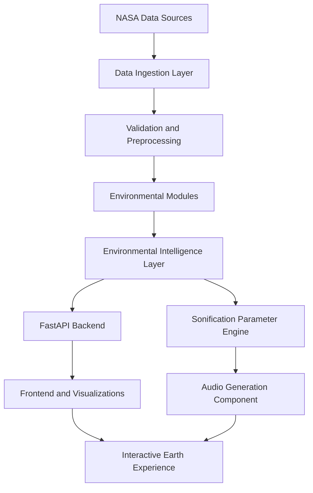

# Earth Jukebox

### Turning Earth's environmental data into intelligence — and intelligence into sound.

[](https://www.nasa.gov/)
[](https://www.python.org/)
[](https://fastapi.tiangolo.com/)
[](https://scikit-learn.org/)
[](https://www.spaceappschallenge.org/)

**Earth Jukebox** is an environmental intelligence and sonification project that explores our planet through NASA Earth-observation data.

It brings together environmental data ingestion, scientific analysis, machine learning, and sonification to transform complex measurements into meaningful insights and an interactive audio experience.

The backend retrieves and processes NASA environmental data, performs supported analytical and predictive tasks, and exposes structured results through a FastAPI service. It also generates sonification parameters that a separate audio engine can use to translate environmental conditions into sound.

> **Our vision:** Make the changing Earth easier to understand — not only through data and visualizations, but also through sound.

---

## Table of Contents

- [Project Overview](#-project-overview)
- [Project Goals](#-project-goals)
- [System Architecture](#-system-architecture)
- [Environmental Modules](#-environmental-modules)
- [Technology Stack](#-technology-stack)
- [NASA Data Sources and APIs](#-nasa-data-sources-and-apis)
- [Data Policy and Scientific Integrity](#-data-policy-and-scientific-integrity)
- [Repository Structure](#-repository-structure)
- [Getting Started](#-getting-started)
- [Configuration](#-configuration)
- [Running the API](#-running-the-api)
- [API Reference](#-api-reference)
- [Example Workflow](#-example-workflow)
- [Machine Learning and Evaluation](#-machine-learning-and-evaluation)
- [Sonification Engine](#-sonification-engine)
- [Interactive Demo](#-interactive-demo)
- [Testing](#-testing)
- [Scientific Limitations](#-scientific-limitations)
- [Roadmap](#-roadmap)
- [Contributing](#-contributing)
- [Acknowledgements](#-acknowledgements)

---

## Project Overview

Earth Jukebox explores eight interconnected environmental themes:

| Module | Environmental focus |
|---|---|
| 🌊 Ocean | Marine and oceanographic conditions |
| 🔥 Fires | Satellite-based active fire observations |
| 🌧️ Rain | Precipitation patterns and analysis |
| ❄️ Ice | Cryosphere and sea-ice conditions |
| 🌪️ Storms | Storm-related environmental observations |
| 🌿 Vegetation | Vegetation health and seasonal changes |
| 💨 Wind | Wind-speed observations and analysis |
| 🌡️ Temperature | Surface and atmospheric temperature conditions |

Each module contributes environmental information to a shared **Environmental Intelligence Layer**.

The resulting information can be used by the frontend for visualization and by the audio-generation component for environmental sonification.

### What makes Earth Jukebox different?

- **NASA-focused data:** Environmental information is sourced from NASA services and NASA-associated data archives selected for the project.
- **Eight environmental dimensions:** Explore multiple aspects of Earth's changing systems.
- **Scientific analysis:** Apply statistical and machine-learning methods where the available data supports them.
- **Environmental intelligence:** Combine information from multiple environmental modules.
- **Data-to-sound integration:** Translate measurements and analytical outputs into structured audio parameters.
- **Scientific transparency:** Communicate data provenance, uncertainty, and limitations.

---

## Project Goals

Earth Jukebox aims to:

1. Retrieve relevant environmental datasets from NASA sources.
2. Preserve dataset provenance, units, timestamps, and spatial coverage.
3. Analyze environmental conditions across eight themes.
4. Apply statistical and machine-learning methods where scientifically appropriate.
5. Provide consistent and documented API responses.
6. Generate structured sonification parameters for the audio engine.
7. Combine environmental information into meaningful intelligence.
8. Communicate uncertainty and scientific limitations clearly.

---

## System Architecture

The backend follows a modular data-processing architecture.



### Core backend responsibilities

| Component | Responsibility |
|---|---|
| Data ingestion | Retrieve data from permitted NASA services |
| Validation | Validate incoming data and coordinate/date parameters |
| Preprocessing | Handle missing values, duplicates, and data formatting |
| Environmental modules | Analyze the eight environmental themes |
| Intelligence layer | Combine outputs from multiple modules |
| ML layer | Perform supported statistical and predictive analysis |
| FastAPI | Expose backend functionality through HTTP endpoints |
| Sonification engine | Convert environmental outputs into acoustic parameters |

The frontend and audio-generation components can operate independently using the backend's documented API contracts.

---

## Environmental Modules

Earth Jukebox contains eight environmental modules.

| Module | Data / analytical focus | Scientific distinction |
|---|---|---|
| 🌊 Ocean | Sea-surface temperature and marine observations | Do not infer unsupported ocean variables or forecasts |
| 🔥 Fires | Active fire detections and occurrence patterns | Fire detections are observations, not predictions of future ignition or spread |
| 🌧️ Rain | Precipitation observations and historical trends | Historical rainfall is not a weather forecast |
| ❄️ Ice | Sea-ice and cryosphere observations | Respect geographical coverage and source resolution |
| 🌪️ Storms | Satellite-based storm-related observations | Observations do not establish cyclone track or intensity forecasts |
| 🌿 Vegetation | NDVI/EVI and vegetation changes | Interpret vegetation indices according to their scientific definitions |
| 💨 Wind | Wind-speed observations and historical analysis | Gridded averages do not necessarily represent local gusts |
| 🌡️ Temperature | Temperature observations, trends, and supported analysis | Specify the measured variable, units, and temporal resolution |

### Module implementation status

The following statuses reflect the backend status reported during development:

| Module | Reported status |
|---|---|
| Temperature | `fully_working` |
| Rain | `fully_working` |
| Wind | `fully_working` |
| Fires | `observation_only` |
| Vegetation | `historical_analysis` |
| Ocean | `historical_analysis` |
| Ice | `historical_analysis` |
| Storms | `observation_only` |

**Important:** A working data-retrieval module is not necessarily a forecasting model. Module status and predictive capability must be documented separately.

For every module, document:

- NASA dataset and official product documentation.
- Dataset or collection identifier.
- Provider or NASA DAAC.
- Variables and units.
- Spatial and temporal resolution.
- Date coverage.
- Authentication requirements.
- Data quality checks and preprocessing.
- Analytical method or model version.
- Evaluation metrics, where applicable.
- Known limitations.

---

## Technology Stack

The backend technology stack includes:

| Technology | Purpose |
|---|---|
| Python 3.11 | Core backend development |
| FastAPI | REST API development |
| Pydantic | Request and response validation |
| NumPy | Numerical computation |
| Pandas | Data processing and manipulation |
| Scikit-learn | Machine-learning workflows |
| Matplotlib | Data visualization |
| Seaborn | Statistical visualization |
| Pytest | Automated testing |
| Uvicorn | ASGI server |

The authoritative dependency list is the repository's `requirements.txt` or `pyproject.toml`. The table describes the project stack, not a requirement to install unused packages.

---

## NASA Data Sources and APIs

Earth Jukebox follows a NASA-only environmental data policy.

The following are official NASA services, product references, and documentation resources relevant to the project.

**An important distinction:** A NASA dataset portal, product documentation page, and operational API are not the same thing. A dataset should only be described as integrated after its actual backend access method has been verified.

### 1. NASA Earthdata and discovery services

| NASA service | Official resource | Purpose |
|---|---|---|
| NASA Earthdata | [Earthdata](https://www.earthdata.nasa.gov/) | Entry point for NASA Earth science data |
| Common Metadata Repository | [CMR Search API](https://cmr.earthdata.nasa.gov/search/site/docs/search/api.html) | Search NASA collections and granules |
| Earthdata Search | [Earthdata Search](https://search.earthdata.nasa.gov/) | Discover datasets by location, time, and topic |
| Earthdata Login | [Data Access Documentation](https://urs.earthdata.nasa.gov/documentation/for_users/data_access) | Authentication for protected NASA resources |

### 2. NASA POWER — Temperature, Rain, and Wind

<details>
<summary>NASA POWER API resources</summary>

| Resource | Official link |
|---|---|
| POWER API documentation | [Temporal API Documentation](https://power.larc.nasa.gov/docs/services/api/) |
| Monthly API | [Monthly API](https://power.larc.nasa.gov/docs/services/api/temporal/monthly/) |
| Daily API | [Daily API](https://power.larc.nasa.gov/docs/services/api/temporal/daily/) |
| Parameter dictionary | [NASA POWER Parameters](https://power.larc.nasa.gov/parameters/) |
| API tutorial | [POWER API Tutorial](https://power.larc.nasa.gov/docs/tutorials/service-data-request/api/) |

Potentially relevant parameter identifiers include:

| Parameter | Meaning |
|---|---|
| `T2M` | Temperature at 2 metres |
| `T2M_MAX` | Maximum temperature at 2 metres |
| `T2M_MIN` | Minimum temperature at 2 metres |
| `PRECTOTCORR` | Corrected precipitation |
| `WS10M` | Wind speed at 10 metres |

Always confirm the parameter definition, community, units, and temporal availability in the official parameter dictionary before using it.

</details>

### 3. NASA FIRMS — Active Fire Detection

<details>
<summary>NASA FIRMS API resources</summary>

| Resource | Official link |
|---|---|
| FIRMS API directory | [FIRMS API](https://firms.modaps.eosdis.nasa.gov/api/) |
| FIRMS Area API | [Area API](https://firms.modaps.eosdis.nasa.gov/api/area) |
| FIRMS API tutorial | [API Usage Tutorial](https://firms.modaps.eosdis.nasa.gov/content/academy/data_api/firms_api_use.html) |

FIRMS provides satellite-based active fire detections from supported MODIS and VIIRS sources.

A valid MAP_KEY is required for applicable API requests.

**Security:** Store the MAP_KEY in an environment variable. Never publish it in source code, documentation, logs, or example URLs.

Fire detections indicate observed thermal anomalies. They must not be represented as predictions of future fire events or fire spread.

</details>

### 4. NASA GPM / IMERG — Precipitation

<details>
<summary>NASA GPM resources</summary>

| Resource | Official link |
|---|---|
| GPM data portal | [NASA GPM Data](https://gpm.nasa.gov/data) |
| IMERG overview | [NASA IMERG](https://gpm.nasa.gov/data/imerg) |
| GPM product directory | [GPM Data Directory](https://gpm.nasa.gov/data/directory) |

GPM IMERG provides precipitation estimates derived from satellite observations and associated processing.

The exact product version, run, temporal resolution, units, and data-access mechanism must be recorded for the product used by the backend.

</details>

### 5. NASA MODIS — Vegetation

<details>
<summary>NASA MODIS resources</summary>

| Resource | Official link |
|---|---|
| MODIS product catalog | [NASA MODIS Data Products](https://modis.gsfc.nasa.gov/data/dataprod/) |
| Vegetation index products | [MODIS MOD13](https://modis.gsfc.nasa.gov/data/dataprod/mod13.php) |

Relevant vegetation products include NDVI and EVI.

The exact collection, product version, quality flags, units, spatial resolution, and temporal resolution must be verified before describing a product as integrated.

</details>

### 6. NASA PO.DAAC — Ocean

<details>
<summary>NASA ocean-data resources</summary>

| Resource | Official link |
|---|---|
| NASA PO.DAAC | [Physical Oceanography DAAC](https://podaac.jpl.nasa.gov/) |
| Earthdata Search | [NASA Earthdata Search](https://search.earthdata.nasa.gov/) |

PO.DAAC provides access to NASA physical-oceanography datasets and related data products.

The exact collection, product identifier, variable, and access endpoint must be documented for the ocean module.

</details>

### 7. NASA Cryosphere Data — Ice

NASA Earthdata can be used to discover relevant cryosphere collections.

| Resource | Official link |
|---|---|
| NASA Earthdata Search | [Earthdata Search](https://search.earthdata.nasa.gov/) |
| NASA CMR API | [CMR Documentation](https://cmr.earthdata.nasa.gov/search/site/docs/search/api.html) |

The exact NASA collection and data archive used by the ice module must be identified.

Do not assume that a product is a NASA-operated dataset simply because it is discoverable through a NASA-related interface. Verify the provider, collection, and archive lineage.

</details>

### Dataset-to-module mapping

| Earth Jukebox module | NASA source family |
|---|---|
| Ocean | NASA Earthdata / PO.DAAC |
| Fires | NASA FIRMS / MODIS / VIIRS |
| Rain | NASA GPM / IMERG |
| Ice | Verified NASA cryosphere collections |
| Storms | Verified NASA satellite and atmospheric observations |
| Vegetation | NASA MODIS vegetation-index products |
| Wind | NASA POWER |
| Temperature | NASA POWER |

### Dataset inventory

For reproducibility, maintain a dataset inventory for every source actually used by the backend.

Each inventory entry should include:

- Module name.
- NASA service, DAAC, or provider.
- Dataset title and short name.
- Collection identifier and version.
- Exact API endpoint or data-access URL, without credentials.
- Variables requested and their units.
- Spatial and temporal resolution.
- Date coverage.
- Authentication requirements.
- Last successful retrieval time.
- Integration status.
- Data provenance and limitations.

---

## 🔬 Data Policy and Scientific Integrity

Scientific reliability is a core requirement of Earth Jukebox.

### NASA-only environmental data

Environmental source data must come from NASA services and eligible NASA data archives.

Do not silently substitute third-party weather, climate, satellite, or geospatial data providers.

Do not present synthetic, random, generated, or cached demonstration values as live NASA observations.

### Result classification

Every analytical result should be assigned an appropriate result type:

| Result type | Meaning |
|---|---|
| `observation` | Data measured or detected by an observing system |
| `historical_analysis` | Analysis of past environmental conditions |
| `risk_estimate` | Estimated risk based on a defined methodology |
| `forecast` | A prediction of future conditions supported by a validated forecasting method |
| `projection` | A conditional estimate under specified assumptions or scenarios |
| `unavailable` | Data or analysis is unavailable |

A model output must never be labelled a forecast merely because it predicts a future numerical value.

### Data provenance

Where available, each response should include:

- NASA source and product/collection identifier.
- Observation and acquisition timestamps.
- Processing timestamp.
- Requested coordinates and spatial coverage.
- Variable name and units.
- Missing-data and quality notes.
- Model name and version.
- Evaluation metadata, where applicable.

---

## Repository Structure

The following is the intended logical structure. Update it to match the actual repository rather than creating unnecessary directories.

```text
earth-jukebox/
│
├── app/
│   ├── main.py
│   ├── api/
│   ├── core/
│   ├── schemas/
│   ├── services/
│   ├── data/
│   ├── modules/
│   │   ├── ocean/
│   │   ├── fires/
│   │   ├── rain/
│   │   ├── ice/
│   │   ├── storms/
│   │   ├── vegetation/
│   │   ├── wind/
│   │   └── temperature/
│   ├── intelligence/
│   └── sonification/
│
├── tests/
├── models/
├── notebooks/
├── scripts/
├── docs/
│
├── demo.html
├── .env.example
├── .gitignore
├── requirements.txt
└── README.md
```

---

## Getting Started

### Prerequisites

- Python 3.11 recommended.
- Git.
- Windows 10/11, macOS, or Linux.
- VS Code or another Python-compatible editor.
- Terminal: PowerShell, Command Prompt, or Bash.

### 1. Clone the repository

```bash
git clone <YOUR_GITHUB_REPOSITORY_URL>
cd earth-jukebox
```

Replace the placeholder with the actual repository URL.

### 2. Create a virtual environment

**Windows PowerShell**

```powershell
py -3.11 -m venv .venv
.venv\Scripts\Activate.ps1
```

If PowerShell blocks script activation, use Command Prompt:

```cmd
.venv\Scripts\activate.bat
```

**macOS / Linux**

```bash
python3.11 -m venv .venv
source .venv/bin/activate
```

### 3. Install dependencies

If the project contains `requirements.txt`:

```bash
python -m pip install --upgrade pip
pip install -r requirements.txt
```

If the project uses `pyproject.toml` or another dependency manager, follow its instructions instead.

### 4. Configure environment variables

Copy the example environment file:

**PowerShell**

```powershell
Copy-Item .env.example .env
```

**macOS / Linux**

```bash
cp .env.example .env
```

Add the credentials required by the NASA services actually used by the project.

### 5. Start the backend

From the repository root:

```bash
uvicorn app.main:app --reload --host 127.0.0.1 --port 8000
```

This command assumes the application entry point is `app.main:app`.

---

## ⚙️ Configuration

The `.env` file contains environment-specific settings.

Example:

```env
ENVIRONMENT=development

API_HOST=0.0.0.0
API_PORT=8000

ALLOWED_ORIGINS=http://localhost:3000,http://127.0.0.1:3000,http://localhost:5173,http://localhost:8000,http://127.0.0.1:8000

# NASA credentials
NASA_EARTHDATA_TOKEN=
NASA_FIRMS_MAP_KEY=

# Storage
CACHE_DIR=./data/cache
MODEL_ARTIFACTS_DIR=./artifacts/models
EVALUATION_DIR=./artifacts/evaluations

# HTTP configuration
HTTP_TIMEOUT_SECONDS=30
HTTP_MAX_RETRIES=3
```

Only retain variables that are actually read by the application.

**Never commit `.env`, API keys, Earthdata tokens, or other private credentials.**

---

## 🔌 Running the API

Once the server starts, the following local URLs are intended to be available:

| Resource | URL |
|---|---|
| API root | [http://127.0.0.1:8000/](http://127.0.0.1:8000/) |
| Health check | [http://127.0.0.1:8000/health](http://127.0.0.1:8000/health) |
| Interactive demo | [http://127.0.0.1:8000/demo](http://127.0.0.1:8000/demo) |
| Swagger documentation | [http://127.0.0.1:8000/docs](http://127.0.0.1:8000/docs) |
| ReDoc documentation | [http://127.0.0.1:8000/redoc](http://127.0.0.1:8000/redoc) |

---

## 📡 API Reference

The backend exposes endpoints for environmental data, analysis, prediction, model evaluation, sonification, and provenance.

The following route inventory reflects the implementation described by the project. Confirm each route, HTTP method, and request schema against the running FastAPI application before treating this table as a complete API contract.

| Method | Endpoint | Purpose |
|---|---|---|
| `GET` | `/` | API root and version |
| `GET` | `/health` | Health and NASA policy status |
| `GET` | `/demo` | Serve the demonstration dashboard |
| `GET` | `/modules` | Report capabilities of all eight modules |
| `GET / POST` | `/observations` | Retrieve supported NASA observations |
| `POST` | `/predict` | Run supported statistical prediction workflows |
| `GET / POST` | `/predict/{condition}` | Condition-specific prediction or historical analysis |
| `GET` | `/evaluate/{condition}` | Evaluate a model against a seasonal-naive baseline |
| `GET / POST` | `/sonification` | Generate sonification parameters |
| `GET / POST` | `/intelligence/analyze` | Combine environmental module outputs |
| `GET / POST` | `/location/analyze` | Validate coordinates and analyze location context |
| `GET` | `/models` | List registered models and validation strategies |
| `GET` | `/models/{condition}` | Retrieve condition-specific model metadata |
| `GET` | `/datasets` | Retrieve dataset catalog |
| `GET` | `/metadata/{condition}` | Retrieve dataset metadata |
| `GET` | `/provenance/{condition}` | Retrieve source and processing provenance |

### Example health-check response

```json
{
  "status": "healthy",
  "timestamp": "2026-11-07T19:02:18.498633Z",
  "nasa_policy_compliance": "STRICT_NASA_ONLY"
}
```

### Example API exploration

Open:

```text
http://127.0.0.1:8000/docs
```

Swagger UI allows you to inspect available endpoints, review request schemas, and test API calls interactively.

---

## Example Workflow

A typical Earth Jukebox request follows this sequence:

1. The frontend submits a location, date range, and environmental category.
2. The API validates coordinates and date chronology.
3. The relevant module retrieves data from its configured NASA source.
4. The preprocessing layer handles missing values, duplicates, and invalid records.
5. The module performs supported observation retrieval, historical analysis, or prediction.
6. The API returns structured information, including units, provenance, result type, and limitations.
7. The Sonification Parameter Engine maps selected environmental variables into acoustic parameters.
8. The frontend visualizes the results, while the audio component uses the returned parameters.

---

## Machine Learning and Evaluation

Machine learning is used only where the available dataset and validation methodology support the intended task.

The reported model-development approach includes:

| Component | Method |
|---|---|
| Baseline | Seasonal-naive persistence, using lag 12 |
| Validation | Chronological 80/20 holdout |
| Features | Autoregressive lags `[1, 2, 12]` |
| Temporal features | Cyclical sine/cosine calendar features |
| Uncertainty | Empirical residual bootstrapping |
| Interval | 95% uncertainty interval |

### Scientific restrictions

- Active fire detections must not be used to claim future fire ignition or spread forecasts.
- Storm observations must not be represented as cyclone track or intensity forecasts.
- Historical trends must not automatically be described as future projections.
- Every predictive model should be compared against an appropriate baseline.
- Future information must never leak into training or validation features.

### Evaluation metrics

Depending on the task, model evaluation can include:

- MAE — Mean Absolute Error.
- MSE — Mean Squared Error.
- RMSE — Root Mean Squared Error.
- R² — Coefficient of Determination.

Report actual evaluation results rather than assuming that a model performs well because it has been implemented.

---

## Sonification Engine

Earth Jukebox translates environmental measurements and analysis outputs into structured acoustic parameters.

The backend is responsible for **parameter generation**, not necessarily the final audio synthesis.

The downstream audio-generation component can use the following parameters:

| Parameter | Description | Intended range |
|---|---|---|
| `pitch_hz` | Frequency in Hertz | 20–20,000 Hz |
| `midi_note` | MIDI pitch value | 0–127 |
| `volume_db` | Audio level | -36 to -6 dB |
| `tempo_bpm` | Rhythmic cadence | 30–240 BPM |
| `rhythm_density` | Rhythm subdivision density | 0–1 |
| `intensity` | Harmonic brightness/filter factor | 0–1 |
| `duration_ms` | Envelope gate duration | Defined in milliseconds |

### Sonification pipeline

```text
NASA Environmental Measurements
              |
              v
      Environmental Analysis
              |
              v
     Parameter Normalization
              |
              v
      Acoustic Mapping
              |
              v
     Sonification Parameters
              |
              v
       Audio Generation
```

The mapping should be deterministic and documented so that the same valid input produces consistent parameters.

The acoustic mapping is a creative representation of environmental measurements; it is not itself a scientific measurement.

---

## Interactive Demo

The project includes a standalone `demo.html` dashboard built using:

- HTML5
- CSS3
- Vanilla JavaScript
- Chart.js
- Web Audio API

### Running the demo

If the FastAPI application serves the demo:

```text
http://127.0.0.1:8000/demo
```

Alternatively, open `demo.html` directly in a browser.

For local development, serving the page through a local HTTP server is preferable to opening it through the `file://` protocol, particularly when browser requests to the backend are involved.

### Reported demo features

- Preset locations.
- Multi-module environmental analysis.
- Time-series visualization.
- 95% uncertainty-band visualization.
- Eight-theme sonification telemetry.
- Web Audio API audition synthesizer.
- Unified environmental intelligence reporting.
- Configurable API base URL.

The dashboard should display unavailable or demonstration-only data clearly and must not label it as live NASA data.

---

## Testing and Code Quality

Run the test suite from the repository root:

```bash
pytest -v
```

The reported automated test suite contains 26 deterministic offline tests covering:

- Schema validation and date chronology.
- NASA adapter parsing.
- Missing-value handling, including `-999.0`.
- Scientific restrictions for fires, storms, and non-polar ice.
- Parallel intelligence-layer synthesis.
- Sonification parameter ranges.
- Physical-value clipping across the eight modules.
- Model serialization and loading.
- Uncertainty interval calculation.

Offline tests validate application behavior without necessarily proving that external NASA services are currently reachable.

For external integration testing, test the actual data-access endpoints separately and record retrieval timestamps and response metadata.

---

## Scientific Limitations

Earth Jukebox is an educational and experimental environmental intelligence project.

Important limitations include:

1. Satellite observations do not automatically provide deterministic future forecasts.
2. FIRMS active fire detections represent observed thermal anomalies, not future fire spread.
3. Historical precipitation observations do not provide flash-flood early warning by themselves.
4. Gridded wind averages may not capture local gusts or highly localized conditions.
5. Storm observations alone do not establish cyclone track or intensity predictions.
6. Cryosphere monitoring must respect the geographical and temporal coverage of the selected dataset.
7. Machine-learning predictions are limited by data quality, sample size, validation methodology, and model assumptions.
8. Sonification is a representation of environmental information, not a substitute for scientific interpretation.

> **Safety notice:** Earth Jukebox is not an emergency response platform and must not be used as an official disaster early-warning system.

---

## Roadmap

The following checklist represents the development milestones reported for the project. Keep it synchronized with the actual repository and test results.

- [x] Identify and document relevant NASA data sources.
- [x] Implement shared ingestion, validation, and provenance utilities.
- [x] Implement the first environmental modules.
- [x] Implement the remaining environmental modules.
- [x] Add model baselines and chronological validation.
- [x] Implement Environmental Intelligence Layer synthesis.
- [x] Define the sonification parameter contract.
- [x] Implement FastAPI schemas and endpoints.
- [x] Build the interactive `demo.html` dashboard.
- [x] Complete the reported 26-test automated test suite.
- [ ] Expand live NASA integration tests.
- [ ] Improve dataset inventory automation.
- [ ] Expand model evaluation and documentation.
- [ ] Improve frontend and audio-engine integration.
- [ ] Prepare deployment and production configuration.

---

## Contributing

Contributions and improvements are welcome.

1. Create a feature branch.
2. Keep changes focused and explain their purpose.
3. Add or update automated tests.
4. Document new datasets, endpoints, models, and configuration.
5. Run the test suite before submitting a pull request.
6. Never commit secrets or private credentials.
7. Avoid unsupported scientific claims.

---

## Acknowledgements

Earth Jukebox is built around NASA Earth-observation data, scientific research, and open environmental data resources.

We acknowledge the work of NASA and its Earth science missions, instruments, data providers, and Distributed Active Archive Centers.

Please cite the exact NASA mission, instrument, product, collection, and DAAC used by each module according to its official acknowledgement and citation guidance.

### Built for the NASA Space Apps Challenge

**Earth Jukebox — Listen to the changing Earth. 🌍🎵**