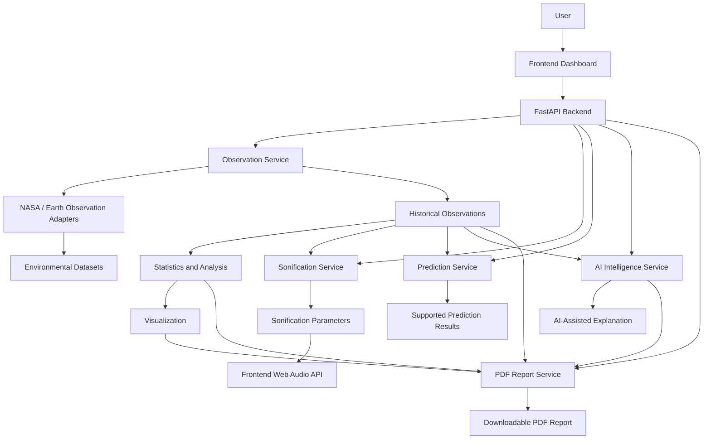

# Earth Jukebox

### Turning Earth's environmental data into intelligence — and intelligence into sound.

[](https://www.python.org/)
[](https://fastapi.tiangolo.com/)
[](https://www.nasa.gov/)
[](https://scikit-learn.org/)
[](https://www.spaceappschallenge.org/)

---

## 🌍 Overview

**Earth Jukebox** is an environmental intelligence and sonification platform that transforms environmental observations into meaningful insights and sound.

The platform retrieves environmental data from configured Earth-observation sources, processes historical observations, performs statistical and machine-learning analysis where supported, and converts environmental patterns into sound.

Users can explore different environmental conditions, examine historical data, listen to their corresponding sound representations, and generate downloadable PDF reports.

The project aims to make environmental information more interactive, accessible, and engaging through the combination of:

- Earth observation datasets
- Python-based data processing
- Machine learning
- Statistical analysis
- FastAPI
- Data visualization
- Audio sonification
- AI-assisted explanations
- PDF report generation

## 🎯 Project Objectives

- Collect and process environmental observations from configured Earth-observation datasets.
- Explore changes in environmental conditions over selected locations and time periods.
- Apply statistical analysis and machine-learning techniques where appropriate.
- Convert environmental measurements into sound using deterministic sonification parameters.
- Present environmental observations through interactive visualizations.
- Generate structured PDF reports containing observations, statistics, charts, data provenance, and limitations.
- Improve public engagement with environmental data through an interactive experience.

## 🌦️ Environmental Modules

Earth Jukebox currently supports eight environmental categories.

| Module | Dataset / Data source | Main purpose |
|---|---|---|
| Temperature | NASA POWER Monthly Surface Temperature | Explore historical temperature patterns |
| Rain | NASA POWER / GPM IMERG precipitation products | Examine precipitation patterns |
| Wind | NASA POWER 10-Meter Wind Speed | Explore historical wind-speed variations |
| Fires | NASA FIRMS VIIRS Active Fire Detections | Examine detected fire hotspots |
| Vegetation | NASA MODIS MOD13 vegetation indices | Explore vegetation-index patterns |
| Ocean | GHRSST MUR Sea Surface Temperature | Analyze historical sea-surface temperature |
| Ice | NSIDC Sea Ice Index (G02135) | Examine polar sea-ice observations |
| Storms | NASA GPM 3IMERGM precipitation product | Explore monthly precipitation patterns relevant to atmospheric conditions |

**Note:** The availability of observations, historical analysis, and prediction differs by module. Not every module supports forecasting. The Storms module's configured GPM monthly precipitation product is not a cyclone-track or storm-intensity forecasting dataset.

---

## 🛰️ Datasets, APIs and Official Data Sources

This section provides the official websites, dataset pages, API documentation, and data portals associated with the environmental modules.

### 1. Temperature — NASA POWER

**Dataset:** NASA POWER Monthly Climate Surface Temperatures  
**Variable:** `T2M`  
**Provider:** NASA Langley Atmospheric Science Data Center

- [NASA POWER Portal](https://power.larc.nasa.gov/)
- [NASA POWER Monthly Point API](https://power.larc.nasa.gov/api/temporal/monthly/point)
- [NASA POWER Monthly API Documentation](https://power.larc.nasa.gov/docs/services/api/temporal/monthly/)

The configured monthly point API provides gridded monthly temperature observations for a specified geographical location and time period.

### 2. Rain — NASA POWER / GPM IMERG

**Dataset:** NASA POWER precipitation and GPM IMERG products  
**Provider:** NASA GES DISC / NASA Langley ASDC

- [NASA POWER](https://power.larc.nasa.gov/)
- [NASA GPM Data Directory](https://gpm.nasa.gov/data/directory)
- [GPM 3IMERGM Dataset — NASA Earthdata](https://disc.gsfc.nasa.gov/datasets/GPM_3IMERGM_07/summary)

These products support the examination of precipitation patterns. Monthly aggregated precipitation should not be interpreted as a real-time flash-flood warning.

### 3. Wind — NASA POWER

**Dataset:** NASA POWER 10-Meter Wind Speed  
**Variable:** `WS10M`  
**Provider:** NASA Langley Atmospheric Science Data Center

- [NASA POWER Portal](https://power.larc.nasa.gov/)
- [NASA POWER Monthly Point API](https://power.larc.nasa.gov/api/temporal/monthly/point)
- [NASA POWER API Documentation](https://power.larc.nasa.gov/docs/services/api/temporal/monthly/)

The configured wind variable represents gridded 10-meter wind-speed information. It should not be interpreted as a measurement of local wind gusts.

### 4. Fires — NASA FIRMS

**Dataset:** NASA FIRMS VIIRS Active Fire Detections  
**Provider:** NASA LANCE / MODAPS

- [NASA FIRMS Portal](https://firms.modaps.eosdis.nasa.gov/)
- [NASA FIRMS API](https://firms.modaps.eosdis.nasa.gov/api/)
- [FIRMS API Usage Documentation](https://firms.modaps.eosdis.nasa.gov/content/academy/data_api/firms_api_use.html)

NASA FIRMS provides satellite-based active fire and thermal anomaly detections. These detections represent observed hotspots, not predictions of future fire ignition or spread.

### 5. Vegetation — NASA MODIS

**Dataset:** MODIS MOD13A2 / MOD13Q1 Vegetation Indices  
**Provider:** NASA LP DAAC

- [NASA MODIS Vegetation Indices](https://ladsweb.modaps.eosdis.nasa.gov/missions-and-measurements/science-domain/vegetation-indices/)
- [MOD13Q1 Product Information](https://ladsweb.modaps.eosdis.nasa.gov/missions-and-measurements/products/MOD13Q1)
- [NASA LP DAAC](https://lpdaac.usgs.gov/)

MODIS vegetation-index products support the analysis of vegetation conditions using satellite-derived indices. Cloud cover and atmospheric effects can introduce gaps or uncertainty in observations.

### 6. Ocean — GHRSST MUR

**Dataset:** GHRSST Level 4 MUR Global Sea Surface Temperature  
**Provider:** NASA PO.DAAC / OB.DAAC

- [MUR Global Sea Surface Temperature Dataset](https://podaac.jpl.nasa.gov/dataset/MUR-JPL-L4-GLOB-v4.1)
- [NASA PO.DAAC](https://podaac.jpl.nasa.gov/)
- [NASA Earthdata Search](https://search.earthdata.nasa.gov/)

The MUR dataset provides global sea-surface temperature information. Coastal areas can be affected by land-mask and spatial-resolution limitations.

### 7. Ice — NSIDC Sea Ice Index

**Dataset:** NSIDC Sea Ice Index (G02135), Version 4  
**Provider:** National Snow and Ice Data Center (NSIDC)

- [NSIDC Sea Ice Index — Dataset Information](https://nsidc.org/data/g02135/versions/4)
- [NSIDC Sea Ice Index Data Archive](https://noaadata.apps.nsidc.org/NOAA/G02135/)
- [NSIDC Sea Ice Index Viewer](https://nsidc.org/data/seaice_index)

**Data-source clarification:** G02135 is an NSIDC dataset associated with NOAA@NSIDC. It should not be described as a dataset produced directly by NASA. Its inclusion should be considered separately when assessing strict NASA-only data-source compliance.

### 8. Storms — NASA GPM

**Dataset:** GPM 3IMERGM Monthly Precipitation  
**Provider:** NASA GES DISC

- [GPM 3IMERGM Dataset](https://disc.gsfc.nasa.gov/datasets/GPM_3IMERGM_07/summary)
- [NASA GPM Data Directory](https://gpm.nasa.gov/data/directory)
- [NASA GES DISC](https://disc.gsfc.nasa.gov/)

The configured product contains monthly precipitation information. It can support historical precipitation analysis but does not provide cyclone tracks, storm trajectories, or storm-intensity forecasts.

**Integration note:** The links above identify the official datasets, portals, and documentation associated with the modules. They do not necessarily represent the exact HTTP request URL used by every backend adapter. The exact request endpoints, parameters, and authentication requirements should be confirmed against the corresponding adapter implementation.

---

## 🏗️ System Architecture

Earth Jukebox follows a modular architecture in which the frontend communicates with a Python FastAPI backend.



### Architecture Components

**1. Frontend Dashboard**

- Allows users to select an environmental category.
- Accepts geographical coordinates and date ranges.
- Supports browser-based location access.
- Displays historical observations and charts.
- Provides audio playback controls.
- Allows PDF report downloads.

**2. FastAPI Backend**

- Exposes REST API endpoints.
- Validates incoming requests.
- Coordinates observation retrieval and processing.
- Provides sonification parameters.
- Connects analysis and reporting services.

**3. Observation Service**

- Retrieves observations through configured data adapters.
- Processes returned time-series data.
- Maintains dataset and source metadata.
- Provides historical observations for visualization and analysis.

**4. Sonification Service**

- Normalizes environmental measurements.
- Maps observations to musical and acoustic parameters.
- Generates deterministic sound profiles.
- Provides structured sonification output to the frontend.

**5. Prediction Service**

- Provides prediction functionality for supported modules.
- Uses the configured model implementation.
- Returns predictions and associated uncertainty information where available.

**6. Intelligence Service**

- Produces AI-assisted explanations based on supplied observations and analytical results.
- Uses Gemini as an interpretation layer when configured.
- Does not use Gemini as an independent environmental data source.

**7. PDF Report Service**

- Generates downloadable environmental reports.
- Includes observations, statistics, charts, data provenance, and limitations.
- Supports compact and detailed report formats.

---

## 🎵 Environmental Sonification

Sonification is the process of representing data through sound.

Earth Jukebox converts environmental observations into sound parameters so that users can explore changes in environmental conditions through audio.

The backend generates structured and deterministic sonification parameters. The frontend uses the Web Audio API to synthesize the corresponding audio.

### Sound Mapping

| Environmental Category | Sound Profile | Frequency Range |
|---|---|---|
| Temperature | Warm analogue sine | 110–880 Hz |
| Rain | Granular percussion | 150–600 Hz |
| Wind | Resonant noise | 80–400 Hz |
| Fires | Staccato pulse | 60–350 Hz |
| Vegetation | Harmonic chords | 130–520 Hz |
| Ocean | Deep sub-bass | 55–220 Hz |
| Ice | Crystalline chimes | 440–1760 Hz |
| Storms | Atmospheric rumble | 65–500 Hz |

### Sonification Parameters

The backend can generate parameters such as:

- Timestamp
- Original environmental value
- Normalized value
- Pitch frequency
- MIDI note
- Musical note
- Volume in decibels
- Tempo
- Rhythm density
- Intensity
- Duration
- Instrument profile

### Sonification Workflow

1. The user selects an environmental category and location.
2. The backend retrieves the relevant observations.
3. The sonification service processes the time-series values.
4. Environmental values are mapped to sound parameters.
5. The backend returns a structured sonification sequence.
6. The frontend synthesizes the sound using the Web Audio API.
7. The user can play, pause, stop, and adjust playback volume.

**Important:** The audio is synthesized from environmental measurements and backend-generated parameters. It is not a recording of the actual environment.

---

## 📊 Data Visualization and Analysis

Earth Jukebox provides visual representations of environmental observations.

The dashboard supports:

- Historical time-series charts.
- Environmental value comparisons.
- Average values.
- Minimum and maximum values.
- Observation counts.
- Dataset and source information.

The visualizations are generated from the observations returned by the backend.

The availability of specific analytical features depends on the environmental module and the returned dataset.

---

## 🤖 Machine Learning and AI Intelligence

Machine learning and statistical techniques support environmental analysis and prediction where implemented.

The prediction service is designed to work with supported environmental categories and their available historical observations.

### AI-Assisted Explanation

Earth Jukebox can use Google's Gemini API to generate explanations based on supplied environmental observations and statistical results.

The AI layer is intended to:

- Explain observed environmental patterns.
- Summarize analytical results.
- Provide understandable descriptions of environmental changes.
- Help users interpret generated reports.

**AI data policy:** Gemini is an explanation layer. Environmental observations must come from the configured data sources, not from AI-generated measurements.

AI-generated explanations may be unavailable when the external service is temporarily unavailable or the API is not configured. The application should continue to provide available non-AI functionality.

---

## 📄 PDF Environmental Reports

Earth Jukebox includes a PDF reporting system that allows users to download environmental analysis reports.

Two report formats are supported:

**Compact Report**

- Environmental category
- Location and date range
- Observation summary
- Key statistics
- Charts
- Data-source information
- Important limitations

**Detailed Report**

- Expanded environmental analysis
- Historical observations
- Statistical information
- Generated charts
- Sonification details
- Data provenance
- AI-assisted summary when available
- Scientific limitations

Reports are generated through the backend using ReportLab and Matplotlib.

### Report Generation Workflow

1. User selects an environmental category.
2. User provides location coordinates and date range.
3. Frontend sends a request to the PDF report endpoint.
4. Backend retrieves the required observations.
5. Report service prepares statistics, charts, and explanations.
6. PDF generator creates the report.
7. The frontend downloads the generated PDF.

---

## 🖥️ Frontend Features

The interactive dashboard provides:

- Environmental category selection.
- Latitude and longitude input.
- Optional location label.
- Browser geolocation support.
- Date-range selection.
- Historical observation visualization.
- Environmental statistics.
- Sonification playback.
- Audio volume controls.
- Compact PDF report download.
- Detailed PDF report download.
- Backend health-status checking.

The frontend uses HTML, CSS, JavaScript, Canvas API, and Web Audio API.

---

## ⚙️ Technology Stack

| Component | Technology |
|---|---|
| Programming Language | Python |
| Backend Framework | FastAPI |
| API Server | Uvicorn |
| Data Processing | NumPy, Pandas |
| Machine Learning | Scikit-learn |
| HTTP Requests | HTTPX |
| Data Visualization | Matplotlib |
| PDF Generation | ReportLab |
| Frontend | HTML, CSS, JavaScript |
| Chart Rendering | Canvas API |
| Audio Generation | Web Audio API |
| AI Explanation | Google Gemini API |
| Testing | Pytest |
| Version Control | Git and GitHub |

---

## 📁 Project Structure

```text
Earth-JukeBox/
│
├── app/
│   ├── main.py
│   │
│   ├── adapters/
│   │   └── Environmental data-source adapters
│   │
│   ├── routes/
│   │   └── API route modules
│   │
│   ├── services/
│   │   └── Observation, prediction, intelligence,
│   │       and sonification services
│   │
│   ├── reports/
│   │   ├── summary_generator.py
│   │   ├── report_service.py
│   │   ├── chart_generator.py
│   │   ├── pdf_generator.py
│   │   └── router.py
│   │
│   └── config.py
│
├── tests/
│
├── demo.html
├── requirements.txt
├── .env.example
├── .gitignore
└── README.md
```

*The structure above is a high-level representation. Actual filenames and directories may vary with the current repository implementation.*

---

## 🚀 Installation and Setup

### Prerequisites

- Python 3.11
- Git
- Visual Studio Code (recommended)
- Internet connection for external data services

### 1. Clone the Repository

```bash
git clone https://github.com/kasidmd34-sudo/Earth-JukeBox.git
```

### 2. Navigate to the Project

```bash
cd Earth-JukeBox
```

### 3. Create a Virtual Environment

```bash
python -m venv .venv
```

### 4. Activate the Virtual Environment

**Windows PowerShell:**

```powershell
.\.venv\Scripts\Activate.ps1
```

**Windows Command Prompt:**

```cmd
.venv\Scripts\activate.bat
```

### 5. Install Dependencies

```bash
pip install -r requirements.txt
```

### 6. Configure Environment Variables

Create a `.env` file in the project root if required.

```env
GEMINI_API_KEY=your_gemini_api_key
```

Use `.env.example` as the template where available.

Do not commit real API keys or secret credentials to GitHub.

### 7. Start the Backend Server

```bash
uvicorn app.main:app --reload
```

### 8. Open the Application

| Resource | URL |
|---|---|
| API Root | http://127.0.0.1:8000/ |
| Interactive API Documentation | http://127.0.0.1:8000/docs |
| Alternative API Documentation | http://127.0.0.1:8000/redoc |
| Frontend Demo | http://127.0.0.1:8000/demo |
| Health Check | http://127.0.0.1:8000/health |

---

## 🔗 API Endpoints

The backend exposes REST endpoints for observations, prediction, sonification, intelligence, evaluation, metadata, and reports.

| Method | Endpoint | Description |
|---|---|---|
| GET | `/` | API root |
| GET | `/health` | Backend health check |
| GET | `/modules` | Available environmental modules |
| POST | `/observations` | Submit an observation request |
| GET | `/observations` | Retrieve environmental observations |
| POST | `/predict` | Submit a prediction request |
| POST | `/predict/{condition}` | Submit a category-specific prediction |
| GET | `/predict/{condition}` | Retrieve category-specific predictions |
| POST | `/intelligence/analyze` | Submit an intelligence analysis request |
| GET | `/intelligence/analyze` | Retrieve an intelligence analysis |
| POST | `/sonification` | Submit a sonification request |
| GET | `/sonification` | Retrieve sonification parameters |
| GET | `/evaluate/{condition}` | Evaluate supported environmental analysis |
| POST | `/location/analyze` | Submit a location analysis request |
| GET | `/location/analyze` | Retrieve location analysis |
| GET | `/datasets` | Retrieve dataset information |
| GET | `/metadata/{condition}` | Retrieve category metadata |
| GET | `/provenance/{condition}` | Retrieve data provenance |
| GET | `/models` | Retrieve available model information |
| GET | `/models/{condition}` | Retrieve category-specific model information |
| GET | `/reports/{condition}/pdf` | Generate and download a PDF report |

For the complete request parameters, response schemas, and examples, run the backend and visit:

`http://127.0.0.1:8000/docs`

---

## 🧪 Testing

The project uses Pytest for testing.

Run the test suite from the project root:

```bash
python -m pytest -v
```

To run individual report-related tests where available:

```bash
python test_chart_generator.py
python test_gemini_summary.py
python test_pdf_generator.py
python test_report_service.py
```

To check Python syntax for report modules:

```bash
python -m py_compile app/reports/pdf_generator.py app/reports/summary_generator.py
```

---

## ☁️ Deployment

Earth Jukebox can be deployed using a hosting service that supports Python applications and long-running FastAPI servers.

### Example: Render

**Build Command**

```bash
pip install -r requirements.txt
```

**Start Command**

```bash
uvicorn app.main:app --host 0.0.0.0 --port $PORT
```

Configure required environment variables through the hosting provider's environment-variable settings.

Ensure that the frontend and backend are deployed together or that the frontend is configured to communicate with the deployed backend URL.

---

## ⚠️ Scientific Limitations and Responsible Data Interpretation

Environmental observations must be interpreted according to their actual spatial and temporal resolution.

Earth Jukebox does not claim that every satellite dataset provides real-time measurements or reliable future forecasts.

| Module | Important limitation |
|---|---|
| Temperature | NASA POWER monthly gridded data does not resolve local urban microclimates or provide direct ground-station measurements. |
| Rain | Monthly precipitation aggregates are not suitable for flash-flood early warning. |
| Wind | Grid-averaged wind speed does not represent local gust dynamics. |
| Fires | Active fire detections identify observed hotspots, not future fire ignition or spread. |
| Vegetation | Cloud cover and atmospheric aerosols can introduce gaps and uncertainty. |
| Ocean | Coastal measurements can be affected by land-mask contamination and spatial resolution. |
| Ice | Sea-ice observations are limited to polar regions and can be affected by retrieval uncertainty. |
| Storms | Monthly precipitation observations do not provide cyclone tracks or storm-intensity forecasts. |

### Responsible Interpretation

- Historical observations must not be presented as future predictions.
- Predictions should only be shown where a supported model is implemented.
- Uncertainty should be communicated when available.
- Data-source information should be preserved.
- AI-generated explanations must not replace the original environmental observations.
- Sonification should be understood as an auditory representation of data, not a direct recording of environmental conditions.

---

## 🔮 Future Scope

Potential future improvements include:

- Expanded integration of verified NASA Earth-observation datasets.
- Improved environmental data quality checks.
- More advanced time-series analysis.
- Additional statistical and machine-learning models where scientifically appropriate.
- Enhanced uncertainty visualization.
- More flexible sonification controls.
- Interactive geographical visualization.
- Improved report customization.
- Expanded accessibility features.
- Better monitoring of data-source availability and provenance.

These are potential development directions and should not be interpreted as already implemented features.

---

## 👨‍💻 Developer

**Project:** Earth Jukebox  
**GitHub:** [kasidmd34-sudo](https://github.com/kasidmd34-sudo)  
**Repository:** [Earth-JukeBox](https://github.com/kasidmd34-sudo/Earth-JukeBox)

---

## 📜 Acknowledgements

Earth Jukebox builds on publicly available Earth-observation resources and scientific datasets.

We acknowledge the work of:

- [NASA](https://www.nasa.gov/)
- [NASA POWER](https://power.larc.nasa.gov/)
- [NASA FIRMS](https://firms.modaps.eosdis.nasa.gov/)
- [NASA GPM](https://gpm.nasa.gov/)
- [NASA Earthdata](https://www.earthdata.nasa.gov/)
- [NASA LP DAAC](https://lpdaac.usgs.gov/)
- [NASA PO.DAAC](https://podaac.jpl.nasa.gov/)
- [NASA GES DISC](https://disc.gsfc.nasa.gov/)
- [National Snow and Ice Data Center](https://nsidc.org/)

---

### 🌎 Earth Jukebox

**Turning Earth's environmental data into intelligence — and intelligence into sound.**